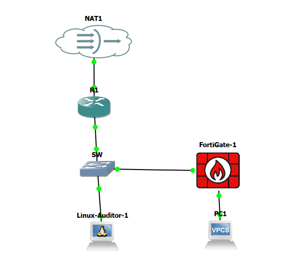
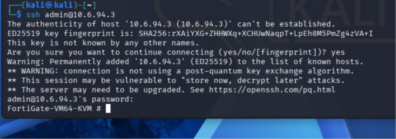
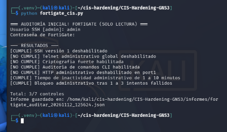
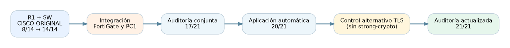
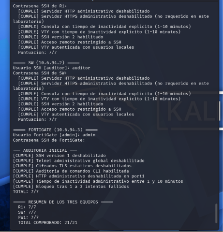

# Hardening CIS orientativo en GNS3 — Router + Switch + FortiGate

## 🎥 Video demostrativo de los TRES dispositivos

**Video :** https://youtu.be/Tyjx94_pSSA?si=VpJnf7BBDm_CCM_c

**Estudiante:** José Miguel Díaz Ferreras  
**Matrícula:** `2025-0693`  
**Herramientas:** GNS3 · Cisco IOS 15.2 · FortiOS 7.0.9 · Kali Linux · Python · Netmiko 4.8.0 · Paramiko 3.5.1.

> Laboratorio académico con controles **seleccionados** de hardening inspirados en criterios CIS. Los porcentajes corresponden a **esta matriz de controles**, no a una certificación CIS Benchmark general.




## 1. Propósito y alcance

**Documentar una sola infraestructura completa: R1 Cisco, SW Cisco, FortiGate, Kali y PC1**, con segmentación de redes, políticas de filtrado, pruebas de tráfico permitido y rechazado, y auditoría/hardening automatizados. Se preservan sin alteraciones todos los scripts, informes y evidencias de las auditorías anteriores de R1 y SW.

## 2. Arquitectura

| Equipo / interfaz | IP | Propósito |
|---|---|---|
| R1 Cisco Fa0/0 | 10.6.94.1/24 | Puerta de enlace principal |
| SW Cisco VLAN1 | 10.6.94.2/24 | Gestión del switch |
| Kali Auditor eth0 | 10.6.94.10/24 | Auditoría y verificación |
| FortiGate port1 | 10.6.94.3/24 | Enlace al SW Gi0/2 |
| FortiGate port2 | 10.6.95.1/24 | Red protegida |
| PC1 VPCS | 10.6.95.10/24 | Pruebas de control de acceso |
| R1 Gi1/0 (WAN) | DHCP vía NAT1 | Salida externa |


## 3. Router R1 y Switch SW — auditoría y hardening

Se configuró el acceso SSHv2 para R1 y SW, con autenticación local, VTY restringidas a SSH, desactivación de servicios HTTP/HTTPS no necesarios en este laboratorio y tiempos `exec-timeout 5 0` para sesiones abandonadas. Se utilizó Kali con Netmiko para comprobar cada control y aplicar cambios previa confirmación. El equipo auditor también probó la conectividad de R1 y SW tras el hardening.

| Dispositivo | Auditoría inicial | Auditoría final |
|---|---:|---:|
| Router R1 | **5/7** | **7/7** |
| Switch SW | **3/7** | **7/7** |
| **Total Cisco** | **8/14** | **14/14** |


## 4. Firewall FortiGate — configuración y pruebas de filtrado

FortiOS 7.0.9 se conecta al switch mediante port1 y protege la subred de PC1 a través de port2. Se configuraron dos subredes y una política explícita `PC1_A_KALI_SOLO_PING` que autoriza únicamente servicio `PING` desde PC1 (`10.6.95.10`) a Kali (`10.6.94.10`) con NAT y logging. Los otros flujos sin política se rechazan por la regla implícita.

**Pruebas finales medidas:** PC1→Kali **5/5**, PC1→SW **0/5**. La consola de FortiGate confirmó cinco veces **`Denied by forward policy check (policy 0)`** para el tráfico PC1→SW; de este modo el bloqueo no se infiere solo por la pérdida de paquetes.





Documentación detallada: [**AMPLIACIÓN FORTIGATE COMPLETA**](docs/AMPLIACION_FORTIGATE.md) · [**PRUEBAS DE TRÁFICO**](docs/PRUEBAS_FORTIGATE_Y_VALIDACION.md) · [extractos FortiGate saneados](configs/FortiGate_fragmentos_verificados_sin_credenciales.txt).

## 5. Script automatizado de los tres dispositivos

El código Python consulta Cisco IOS y FortiOS a través de SSH. **`auditar` no modifica** los dispositivos; **`aplicar` requiere confirmación `APLICAR`**, solicita las credenciales sin almacenarlas y comprueba el estado posterior. Al ejecutarse, guarda JSON en `scripts/informes/`.

| Archivo | Función |
|---|---|
| [`scripts/cis_hardening.py`](scripts/cis_hardening.py) | **Script Cisco original intacto**: 2 dispositivos, 2 modos |
| [`scripts/cis_tres_dispositivos.py`](scripts/cis_tres_dispositivos.py) | **Programa integrado nuevo**: R1 + SW + FortiGate |
| [`scripts/cis_cisco_base.py`](scripts/cis_cisco_base.py) | Funciones de auditoría/aplicación Cisco para el programa integrado |
| [`scripts/fortigate_cis_v2.py`](scripts/fortigate_cis_v2.py) | Funciones auditables de FortiGate, con control TLS alternativo |
| [`scripts/requirements.txt`](scripts/requirements.txt) | Dependencias del ambiente de Python (revisar versiones compatibles) |

Desde la raíz del repositorio, en un entorno con acceso y permiso a los equipos:

```bash
python scripts/cis_tres_dispositivos.py auditar
```


## 6. Resultados y comparación 



| Momento | Cisco R1 | Cisco SW | FortiGate | Resultado |
|---|---:|---:|---:|---:|
| Auditoría Cisco (registro inicial) | 5/7 | 3/7 | — | **8/14** |
| Auditoría Cisco (registro posterior) | 7/7 | 7/7 | — | **14/14** |
| Auditoría conjunta, antes del hardening FortiGate | 7/7 | 7/7 | 3/7 | **17/21** |
| Tras aplicar automáticamente los cambios al firewall | 7/7 | 7/7 | 6/7 | **20/21** |
| Auditoría final con **matriz revisada** | 7/7 | 7/7 | 7/7 | **21/21** |



[**Leer cronología y explicación técnica completa**](docs/RESULTADOS_COMPARATIVOS_3_DISPOSITIVOS.md) · [**Ver los 5 informes auténticos de la nueva fase**](docs/informes/fase_tres_dispositivos/).


