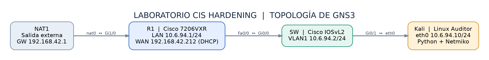
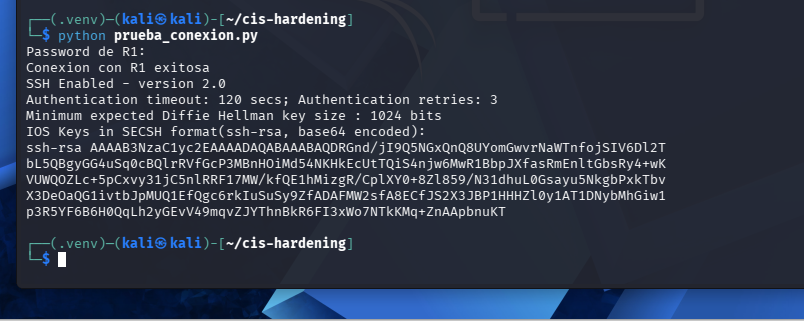
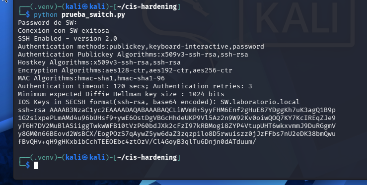
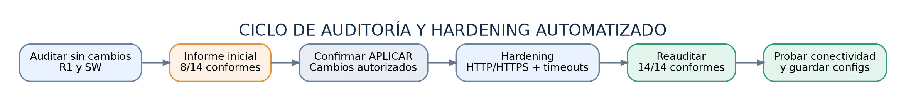
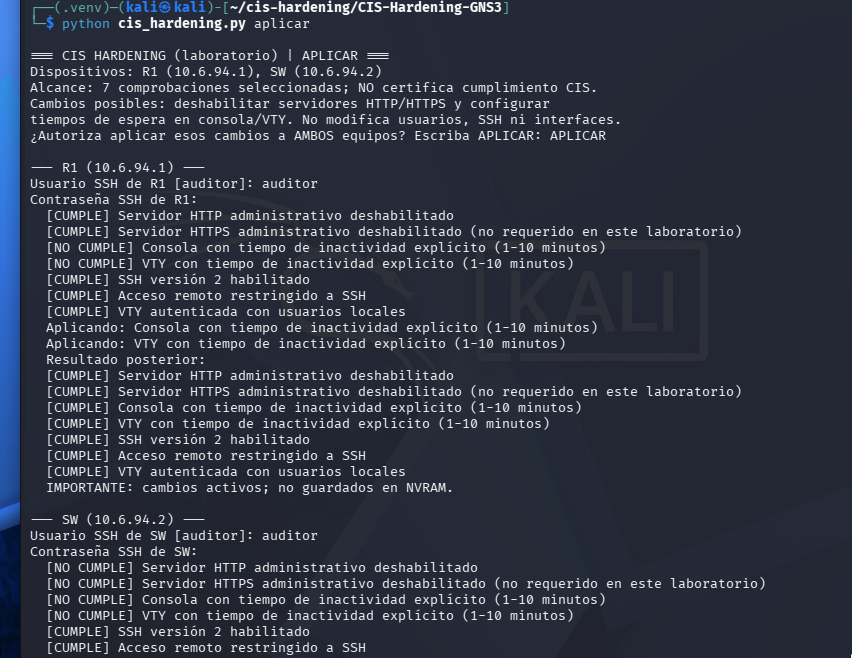
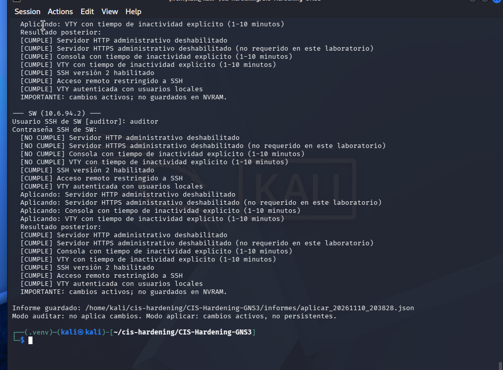
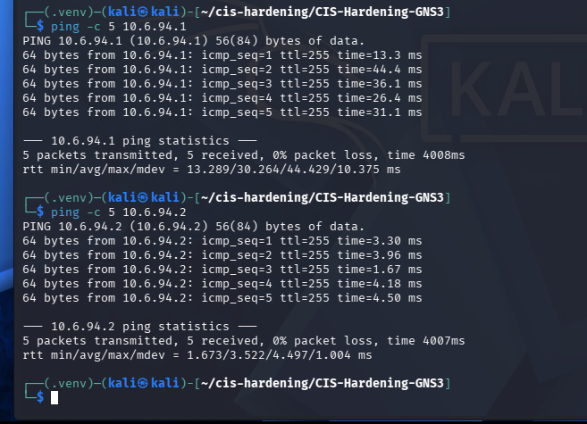

# Infraestructura 2 — Hardening CIS Benchmark en GNS3

## 🎥 Video demostrativo — objetivo de Seguridad de Redes

**[Ver el video en YouTube: demostración de auditoría y hardening CIS](https://youtu.be/4RRuTz3-xdg)**

Enlace directo: https://youtu.be/4RRuTz3-xdg

**Estudiante:** José Miguel Díaz Ferreras  
**Matrícula:** `2025-0693`  
**Entorno:** GNS3 · Cisco IOS 15.2 · Kali Linux · Python · Netmiko

> Proyecto académico realizado sobre dispositivos de laboratorio propios en GNS3. La evaluación automatizada comprende **siete controles seleccionados por equipo**; no equivale a una auditoría CIS certificada.

## Propósito

Implementar una topología de router y switch Cisco, evaluar su configuración de administración utilizando criterios de hardening inspirados en **CIS Benchmarks**, aplicar las recomendaciones seleccionadas mediante un **script Python automatizado** y demostrar el estado de seguridad **antes y después** sin perder la conectividad de red.

## Arquitectura

- **NAT1:** proporciona acceso a la red externa de la simulación.
- **R1 — Cisco 7206VXR:** router con Cisco IOS `15.2(4)S6`, dirección LAN `10.6.94.1/24` y WAN `192.168.42.212/24` por DHCP.
- **SW — Cisco IOSvL2:** conmutador virtual con IOS 15.2 experimental; administración `Vlan1: 10.6.94.2/24`.
- **Kali Linux Auditor:** máquina QEMU conectada al switch por `eth0: 10.6.94.10/24`. Ejecuta Python, Netmiko y el script de auditoría/hardening.

**Topología real:** [Ver captura GNS3](images/evidencias/cisco_01_topologia_gns3_real.png) · **Flujo automatizado:** [Ver diagrama](images/evidencias/diagrama_flujo_auditoria.png)

## Direccionamiento IPv4

| Equipo / interfaz | Dirección | Función |
|---|---|---|
| NAT1 | Puerta de enlace `192.168.42.1` | Salida externa |
| R1 — Fa0/0 | `10.6.94.1/24` | Gateway LAN |
| R1 — Gi1/0 | `192.168.42.212/24` (DHCP observado) | Enlace externo / NAT |
| SW — VLAN 1 | `10.6.94.2/24` | Gestión del switch |
| Kali — eth0 | `10.6.94.10/24` | Auditoría SSH |

## Servicios y herramientas implementados

### 1. Conectividad y acceso administrativo

La LAN permitió la comunicación entre Kali, R1 y SW. El router proporcionó NAT/PAT de salida para instalar dependencias. Se habilitó **SSH versión 2** en ambos dispositivos, con usuario de administración local y transporte VTY restringido a SSH.

### 2. Herramienta de análisis de seguridad

El archivo [`scripts/cis_hardening.py`](scripts/cis_hardening.py) se ejecuta en Kali con Python y Netmiko. Evalúa siete controles técnicos por equipo mediante consultas de configuración y estado SSH.

| Modo | Comando | Resultado |
|---|---|---|
| **Auditar** | `python scripts/cis_hardening.py auditar` | Evalúa sin modificar; genera JSON |
| **Aplicar** | `python scripts/cis_hardening.py aplicar` | Pide confirmación, corrige controles seleccionados y genera JSON posterior |

Los informes del script se crean junto al archivo Python, en `scripts/informes/`, si se ejecuta desde esta organización. Los **informes JSON originales de la ejecución del estudiante** están incluidos en [`docs/informes/`](docs/informes/).

### 3. Controles de hardening seleccionados

| Control | Objetivo | Aplicación |
|---|---|---|
| HTTP administrativo | Deshabilitar HTTP no requerido | SW |
| HTTPS administrativo | Deshabilitar HTTPS no requerido **en este laboratorio** | SW |
| `exec-timeout` consola | Cerrar sesiones locales inactivas | R1 y SW |
| `exec-timeout` VTY | Cerrar sesiones remotas inactivas | R1 y SW |
| SSHv2 | Evitar versiones antiguas del protocolo | Preparado en R1 y SW |
| VTY solo SSH | Evitar Telnet | Preparado en R1 y SW |
| `login local` | Autenticación con usuarios locales | Preparado en R1 y SW |

**Por qué se aplicaron:** reducir servicios de administración innecesarios, limitar sesiones abandonadas y utilizar accesos administrativos autenticados. [Leer justificación y alcance](docs/RECOMENDACIONES_Y_CIS.md).

## Auditoría inicial (sin cambios)

Antes de ejecutar el modo de aplicación, se realizó una auditoría automatizada. **La preparación de SSH ya había sido realizada para permitir que Kali se conectara a los equipos**; ese cambio previo está diferenciado del hardening automatizado.

| Equipo | Controles que cumplen | Controles por corregir |
|---|---:|---:|
| R1 | 5/7 | 2 |
| SW | 3/7 | 4 |
| **Total** | **8/14** | **6** |

## Hardening automatizado y resultados

El modo `aplicar` solicitó la autorización `APLICAR`, configuró los controles pendientes y comprobó inmediatamente sus resultados.

### Comparación de resultados

| Dispositivo | Antes | Después |
|---|---:|---:|
| R1 | 5/7 | **7/7** |
| SW | 3/7 | **7/7** |
| **Total de controles seleccionados** | **8/14** | **14/14** |

**Resultado:** los **14 controles evaluados por este script** quedaron conformes tras los cambios. Esto no es un 100 % de cumplimiento del benchmark CIS general.

## Seguridad y validación

Después del hardening, desde Kali se verificó **5/5 respuestas a R1** y **5/5 a SW**, sin pérdida de paquetes. También se confirmó el guardado de configuración de ambos dispositivos en startup-config.

- Las conexiones SSH a plataformas IOS antiguas requirieron compatibilidad de Paramiko 3.5.1. Esto se documenta como **limitación tecnológica**, no como recomendación de endurecimiento.
- No se publican contraseñas reales, claves privadas ni imágenes propietarias Cisco.
- Solo se verificaron siete controles predefinidos por equipo; la evaluación integral de CIS requiere otros controles y el benchmark correspondiente a la versión real de IOS.
- Los running-configs finales de R1 y SW se incorporaron como copias documentales saneadas; se omitieron hashes y banners legales repetidos.

## Informes y documentación técnica

Los **tres archivos JSON originales** se incorporaron sin modificaciones: [auditoría inicial (8/14)](docs/informes/auditar_20261110_202713.json), [aplicación de hardening](docs/informes/aplicar_20261110_203828.json) y [auditoría final (14/14)](docs/informes/auditar_20261110_204226.json). El script registra que no guardó automáticamente en NVRAM (`guardado_en_nvram: false`); posteriormente el estudiante confirmó el guardado manual en ambos equipos.

| Documento | Contenido |
|---|---|
| [Documento técnico en Word](docs/Documento_Tecnico_CIS_Hardening_Jose_Miguel_Diaz_Ferreras.docx) | Informe profesional editable con imágenes y resultados |
| [Documento técnico en PDF](docs/Documento_Tecnico_CIS_Hardening_Jose_Miguel_Diaz_Ferreras.pdf) | Versión final para lectura y entrega |
| [Documento técnico en Markdown](docs/DOCUMENTO_TECNICO.md) | Explicación del laboratorio y resultados reales |
| [Recomendaciones y justificación](docs/RECOMENDACIONES_Y_CIS.md) | Siete reglas, razones y estados |
| [Pruebas y evidencias](docs/PRUEBAS_Y_EVIDENCIAS.md) | Capturas organizadas por fases |
| [Incidencias y soluciones](docs/INCIDENCIAS_Y_SOLUCIONES.md) | Problemas y soluciones verificadas |
| [Guía de reproducción](docs/GUIA_DE_REPRODUCCION.md) | Cómo ejecutar ambos modos |
| [Índice de imágenes](docs/INDICE_DE_EVIDENCIAS.md) | Lista de capturas originales |
| [Informes de ejecución](docs/informes/README.md) | Tres informes JSON originales: antes, aplicación y auditoría final |
| [Matriz de requisitos](docs/MATRIZ_DE_REQUISITOS.md) | Qué exige el profesor y qué está completo |
| [Guía para GitHub](docs/COMO_PUBLICAR_EN_GITHUB.md) | Cómo subir con la estructura de carpetas correcta |

## Running-configs finales (copia saneada)

- [R1 - running-config final](configs/R1_running-config_final_sanitizado.txt)
- [SW - running-config final](configs/SW_running-config_final_sanitizado.txt)

Se han sustituido los hashes de contraseñas y omitido el texto legal largo de los banners de IOSv. Estos archivos preservan las líneas técnicas relevantes y **no deben usarse como configuraciones de restauración**.

## Archivos del repositorio

| Carpeta | Contenido |
|---|---|
| [`configs/`](configs/) | Running-configs finales saneados de R1 y SW, más extractos originales anteriores a SSH |
| [`docs/`](docs/) | Documentación técnica, recomendaciones, pruebas e informes |
| [`images/`](images/) | Diagrama lógico, flujo y capturas reales del laboratorio |
| [`scripts/`](scripts/) | Script de auditoría/hardening original, dependencias y exportador de configuraciones |

## Resultado general

Se configuró una topología funcional en GNS3, se automatizó la evaluación de siete controles de hardening por dispositivo Cisco, se aplicaron correcciones aprobadas y se comprobó el cambio de **8/14 a 14/14** sin perder conectividad. Los tres JSON originales están incluidos. Los running-configs finales saneados y los tres informes JSON originales ya están incorporados. **El enlace del video demostrativo de esta práctica ya está incluido al inicio del README.** La publicación final del repositorio en GitHub debe realizarla el estudiante.

**Fuentes de referencia:** [CIS Cisco Benchmarks](https://www.cisecurity.org/benchmark/cisco) · [Cisco Harden IOS Devices](https://www.cisco.com/c/en/us/support/docs/ip/access-lists/13608-21.html).
