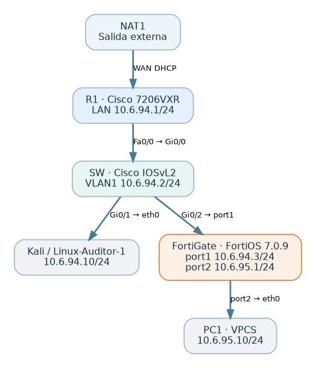
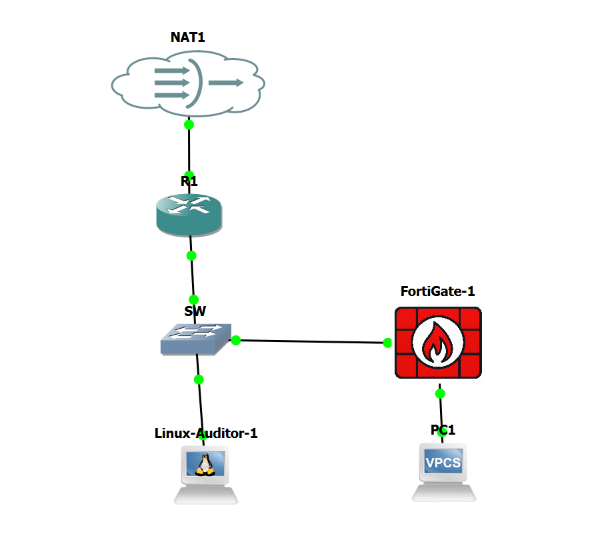
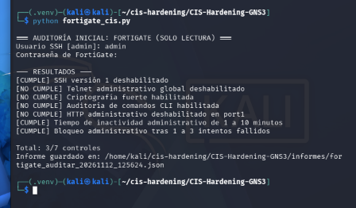
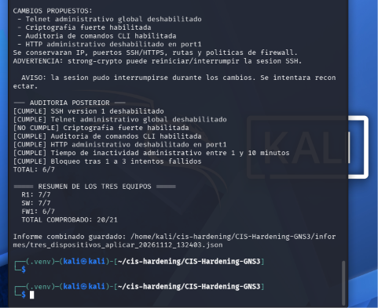
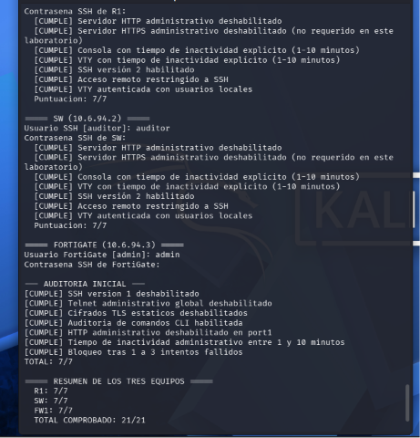

# Ampliación técnica: FortiGate (fase nueva)

**Estudiante:** José Miguel Díaz Ferreras · **Matrícula:** 2025-0693  
**Plataforma:** GNS3, FortiGate-VM64-KVM, FortiOS 7.0.9 (build0444), Kali Linux, Python/Netmiko.  
**Relación con la fase original:** esta ampliación **NO sustituye** ningún contenido Cisco; conserva el router R1, el switch SW, sus auditorías originales de 8/14 y 14/14, las pruebas de SSH, las capturas y las configuraciones saneadas.

## 1. Propósito

Integrar un firewall real dentro de la topología GNS3, segmentar una red de pruebas, demostrar filtrado de tráfico con política explícita y denegación implícita, y ampliar la auditoría automática a tres dispositivos con los modos `auditar` y `aplicar`.

## 2. Topología y direcciones

| Equipo/interfaz | Dirección | Función |
|---|---|---|
| R1 — Fa0/0 | 10.6.94.1/24 | Puerta de enlace de la red Cisco existente |
| SW — Vlan1 | 10.6.94.2/24 | Administración del switch |
| Kali — eth0 | 10.6.94.10/24 | Auditoría y destino ICMP autorizado |
| FortiGate — port1 | 10.6.94.3/24 | Enlace hacia SW Gi0/2 |
| FortiGate — port2 | 10.6.95.1/24 | Puerta de enlace de la red protegida |
| PC1 — Ethernet0 | 10.6.95.10/24 | Origen de pruebas detrás de FortiGate |

La rama de FortiGate se añadió a SW y **no reemplazó el camino NAT1–R1–SW–Kali**. Así se conservaron los ensayos anteriores. `port1` y `port2` pertenecen a subredes diferentes para permitir el filtrado entre redes.

## 3. Configuración y conexión del firewall

La VM informó `FortiOS 7.0.9`, licencia de evaluación válida durante el laboratorio, modo NAT y puertos `port1`–`port10`. Se configuró `port1` con `10.6.94.3/24`, `port2` con `10.6.95.1/24` y PC1 con `10.6.95.10/24`, gateway `10.6.95.1`. El ping FortiGate↔SW se verificó en ambos sentidos con 5/5 respuestas, y Kali→FortiGate con 5/5 después de restaurar la IP de `eth0` al reiniciar Kali.

La autenticación SSH desde Kali hacia FortiGate funcionó; Netmiko 4.8.0 y Paramiko 3.5.1 se recuperaron del entorno virtual `~/cis-hardening/.venv` para conservar la compatibilidad con los Cisco IOS antiguos. Las contraseñas se introducen interactivamente, no se guardan en el repositorio.

## 4. Política de filtrado y pruebas

Se crearon dos objetos de host: `PC1_10.6.95.10` y `KALI_10.6.94.10`. Se verificó `show firewall policy` con la regla 1 `PC1_A_KALI_SOLO_PING`: tráfico desde `port2` a `port1`, origen PC1, destino Kali, servicio `PING`, acción `accept`, NAT habilitado y `logtraffic all`.

**Pruebas después de configurar la política**:

| Flujo | Resultado medido | Interpretación |
|---|---|---|
| PC1 → 10.6.95.1 (FortiGate) | 5/5 | Enlace con port2 correcto |
| Kali → 10.6.94.3 (FortiGate) | 5/5 | Gestión desde red existente correcta |
| PC1 → 10.6.94.10 (Kali) | 5/5 | Permitido por política explícita de ping |
| PC1 → 10.6.94.2 (SW) | 0/5 | No autorizado por ninguna regla |

La salida de `diagnose debug flow` mostró para cinco intentos ICMP hacia SW: **`Denied by forward policy check (policy 0)`**, confirmación del descarte por denegación implícita. Un ping fallido aislado no bastaría para demostrar la causa; por eso se verificó con depuración.

## 5. Auditoría inicial del firewall

Se revisaron siete controles de administración de FortiOS mediante script solo lectura. Resultado **3/7**: ya cumplían SSHv1 deshabilitado, inactividad administrativa de 5 minutos y umbral de bloqueo de 3 intentos. Pendían Telnet administrativo global, auditoría CLI, HTTP en port1 y criptografía fuerte (`strong-crypto` en la primera matriz). Se conservaron los JSON originales.

## 6. Aplicación automatizada e incidencia real

En el modo `aplicar`, la auditoría conjunta pasó de **17/21 a 20/21**. El script deshabilitó Telnet global, habilitó registro de comandos CLI y retiró HTTP de `port1`, conservando SSH. El intento `set strong-crypto enable` recibió **`command parse error`**, código **-61**; la instancia no ofrecía ese parámetro dentro de `config system global` aunque `get system global` lo mostraba como `disable`. **No se presenta como aplicado.**

Se identificó un control criptográfico **alternativo, no equivalente**: `ssl-static-key-ciphers`. Se aplicó manualmente `set ssl-static-key-ciphers disable` y se verificó con `get system global | grep ssl-static-key-ciphers` → `disable`. Se ajustó el script de la versión actualizada para evaluar ese control accesible en este FortiOS. Los resultados originales 17/21 y 20/21 permanecen intactos.

## 7. Auditoría final actualizada

La auditoría con la **matriz revisada** produjo R1 7/7, SW 7/7 y FortiGate 7/7, total **21/21**. El informe de comparación explica claramente la sustitución del control y por qué el resultado 21/21 no puede interpretarse como cumplimiento del `strong-crypto` original ni como certificación del CIS Benchmark. Se repitió PC1→Kali (5/5) y PC1→SW (0/5), manteniendo la segmentación.

## 8. Limitaciones y recomendaciones

- **Matriz seleccionada, no certificación:** las 21 reglas son checks acotados del laboratorio; no sustituyen un benchmark integral por versión/dispositivo.
- **FortiOS 7.0.9:** firmware antiguo de laboratorio; antes de un despliegue productivo comprobar soporte, parches y actualizaciones.
- **Administración:** restringir SSH/HTTPS a un segmento o IP de administración (`trusthost`), conservar copia respaldada y usar autenticación fuerte cuando sea posible.
- **SSH Cisco antiguo:** se usaron bibliotecas/algoritmos compatibles solo en un laboratorio aislado; no recomendar SSH débil en producción.
- **Evidencias:** no publicar hashes, claves, comunidades SNMP, certificados privados ni running-configs sin sanear.
- **FortiGate running-config:** aquí se documentan fragmentos reales verificados y sin secretos, no un respaldo integral exportado.

## 9. Ubicación de archivos

- Script conjunto actualizado: [`../scripts/cis_tres_dispositivos.py`](../scripts/cis_tres_dispositivos.py)
- Módulo Cisco: [`../scripts/cis_cisco_base.py`](../scripts/cis_cisco_base.py)
- Módulo FortiGate actualizado: [`../scripts/fortigate_cis_v2.py`](../scripts/fortigate_cis_v2.py)
- Informes: [`informes/fase_tres_dispositivos/`](informes/fase_tres_dispositivos/)
- Configuración firewall (fragmentos): [`../configs/FortiGate_fragmentos_verificados_sin_credenciales.txt`](../configs/FortiGate_fragmentos_verificados_sin_credenciales.txt)
- Procedimiento original intacto Cisco: [`../README_CISCO_SW_ORIGINAL.md`](../README_CISCO_SW_ORIGINAL.md)
