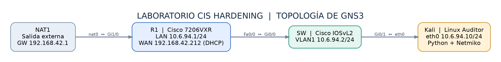
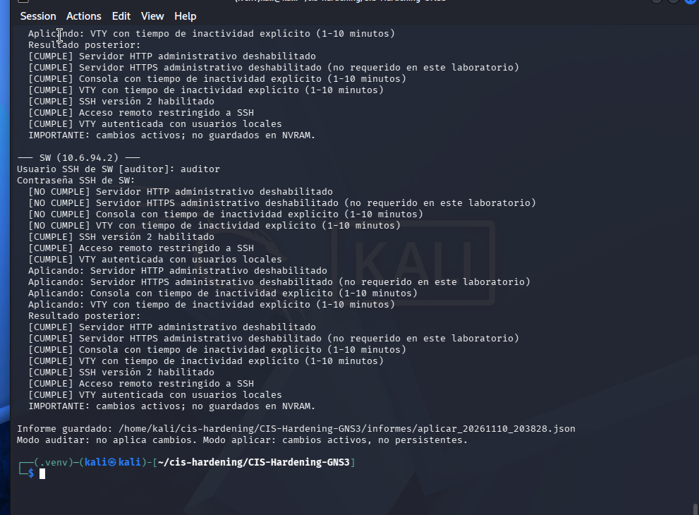
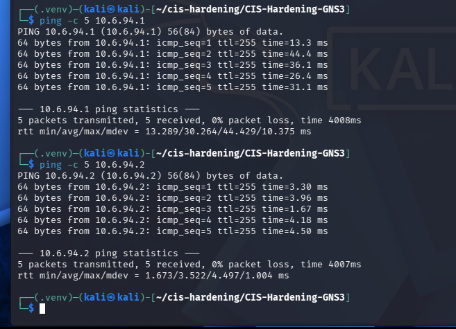

# Documento técnico — Laboratorio CIS Hardening en GNS3

**Video demostrativo del laboratorio:** https://youtu.be/4RRuTz3-xdg

**Estudiante:** José Miguel Díaz Ferreras  
**Matrícula:** 2025-0693  
**Fecha de ejecución:** 10 de noviembre de 2026  
**Herramientas:** GNS3, Cisco IOS 15.2, Kali Linux, Python 3.13, Netmiko 4.8.0 y Paramiko 3.5.1.

## Objetivo y alcance

Crear una red virtual con router y switch; evaluar un conjunto **acotado de siete controles** inspirados en guías de hardening Cisco IOS y CIS Benchmark; ejecutar auditoría sin cambios; aplicar controles seleccionados con confirmación; volver a evaluar la seguridad y validar que se conserva la conectividad.

No se utilizó CIS-CAT ni se realizó una comprobación de todas las recomendaciones de CIS. La evaluación es **orientativa y académica**, sin certificación de conformidad oficial. Se deben contrastar las recomendaciones con el benchmark correspondiente a la versión del equipo.

## Topología

| Dispositivo | Software/plataforma | IP y función |
|---|---|---|
| NAT1 | NAT GNS3 | gateway externo 192.168.42.1 |
| R1 | Cisco 7206VXR, IOS 15.2(4)S6 | Fa0/0 10.6.94.1/24; Gi1/0 192.168.42.212 por DHCP |
| SW | IOSvL2, IOS 15.2 experimental (2020) | VLAN1 10.6.94.2/24 |
| Linux Auditor | Kali Linux QEMU | eth0 10.6.94.10/24 |

R1 recibió acceso externo mediante NAT1, configuró PAT para la LAN y permitió que Kali descargase dependencias de Python. Desde Kali se comprobó comunicación con ambos dispositivos por ICMP y SSH.

## Preparación del acceso automatizado

Se habilitó SSHv2 en R1 y SW con claves RSA y autenticación local en las VTY, y se restringió el transporte remoto a SSH. Esta **fase se ejecutó antes de la primera auditoría automatizada**, por lo que los resultados 8/14 representan la línea base **posterior a la preparación de SSH**, no la configuración original de fábrica.

En IOS 15.2 se observó incompatibilidad con algoritmos SSH modernos. Se utilizó una versión compatible de Paramiko (3.5.1) en el entorno virtual para las pruebas del laboratorio. Esta excepción **no constituye una recomendación de seguridad** para producción; corresponde actualizar o sustituir la plataforma cuando proceda.

## Auditoría inicial

Mediante `python cis_hardening.py auditar`, el script conectó a R1 y SW y consultó `show running-config` y `show ip ssh` sin aplicar comandos de configuración.

- R1: cinco controles conformes de siete; pendientes `exec-timeout` en consola y VTY.
- SW: tres controles conformes de siete; pendientes deshabilitar HTTP, HTTPS y configurar `exec-timeout` en consola y VTY.

## Hardening aplicado y por qué

| Cambio | Motivo | Equipo afectado |
|---|---|---|
| `no ip http server` | Reducir superficie de administración HTTP innecesaria | SW |
| `no ip http secure-server` | Deshabilitar HTTPS administrativo no requerido en este montaje; no implica que HTTPS sea intrínsecamente inseguro | SW |
| `line con 0` + `exec-timeout 5 0` | Limitar duración de sesiones locales abandonadas | R1, SW |
| `line vty 0 4` + `exec-timeout 5 0` | Limitar duración de sesiones SSH inactivas | R1, SW |

Controles adicionales ya preparados: `ip ssh version 2`, `login local`, `transport input ssh`. No se declara cumplimiento de otras áreas como AAA, protección SNMP, gestión de certificados, monitoreo centralizado ni ACL de administración.

## Resultados posteriores

Con el modo `aplicar`, el script exigió la palabra `APLICAR`, ejecutó cambios solo para controles incumplidos y generó un informe posterior. Se volvió a ejecutar `auditar` para validación independiente.

| Dispositivo | Antes | Después |
|---|---:|---:|
| R1 | 5/7 | 7/7 |
| SW | 3/7 | 7/7 |
| **Total** | **8/14** | **14/14** |

Tras aplicar los cambios, Kali obtuvo **5/5 respuestas ICMP** a R1 y **5/5** a SW. El estudiante confirmó además que guardó ambas configuraciones mediante `copy running-config startup-config`.

## Límites de la evidencia

Los 14/14 indicadores pertenecen al conjunto de controles que verifica este programa, **no** equivalen a 100 % de cumplimiento del CIS Benchmark. Los tres JSON originales generados en Kali ya están incluidos en `docs/informes/`. Los running-configs finales de R1 y SW ya están incorporados en `configs/` como copias documentales saneadas; las líneas con hashes y los banners legales repetidos se omitieron para publicación. No publicar passwords, hashes, SNMP communities ni imágenes propietarias del software Cisco.

## Versiones del documento

- [Word editable](Documento_Tecnico_CIS_Hardening_Jose_Miguel_Diaz_Ferreras.docx)
- [PDF](Documento_Tecnico_CIS_Hardening_Jose_Miguel_Diaz_Ferreras.pdf)
