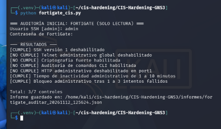
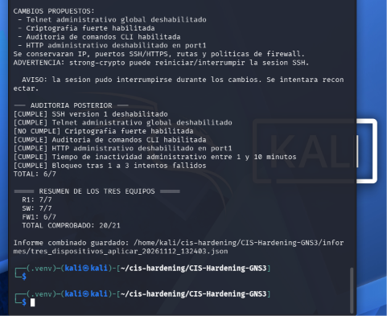
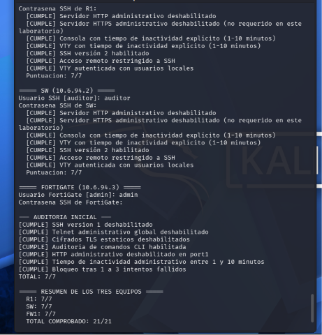

# Pruebas funcionales — Router, Switch, FortiGate (evidencia de laboratorio)

## Cisco R1 + SW (fase original, intacta)

- Se prepararon SSHv2, usuario local `auditor` (contraseña no publicada), VTY solo SSH y tiempos de sesión; el programa ejecutó auditorías en ambos dispositivos.
- **Antes:** R1 5/7 y SW 3/7, total 8/14.
- **Después:** R1 7/7 y SW 7/7, total 14/14.
- Ping Kali→R1 y Kali→SW: **5/5** cada uno después del hardening.
- Se guardó manualmente la configuración de ambos dispositivos en startup-config. Los archivos publicados están saneados.

Véase el archivo original [`PRUEBAS_Y_EVIDENCIAS.md`](PRUEBAS_Y_EVIDENCIAS.md), que se preservó sin cambios.

## FortiGate: direccionamiento y rutas

| Comprobación | Evidencia |
|---|---|
| `port1` FortiGate → SW `10.6.94.2` | 5 respuestas, sin pérdida |
| SW `10.6.94.2` → FortiGate `10.6.94.3` | 5 respuestas, sin pérdida |
| Kali `10.6.94.10` → FortiGate `10.6.94.3` | 5 respuestas, sin pérdida |
| PC1 `10.6.95.10` → FortiGate `10.6.95.1` | 5 respuestas, sin pérdida |

## Política 1: solo ping de PC1 a Kali

Salida de `show firewall policy` verificada:

```text
edit 1
    set name "PC1_A_KALI_SOLO_PING"
    set srcintf "port2"
    set dstintf "port1"
    set action accept
    set srcaddr "PC1_10.6.95.10"
    set dstaddr "KALI_10.6.94.10"
    set schedule "always"
    set service "PING"
    set logtraffic all
    set nat enable
next
```

### Prueba permitida

```text
PC1> ping 10.6.94.10
84 bytes from 10.6.94.10 icmp_seq=1 ttl=63 time=7.821 ms
84 bytes from 10.6.94.10 icmp_seq=2 ttl=63 time=7.872 ms
84 bytes from 10.6.94.10 icmp_seq=3 ttl=63 time=8.432 ms
84 bytes from 10.6.94.10 icmp_seq=4 ttl=63 time=2.573 ms
84 bytes from 10.6.94.10 icmp_seq=5 ttl=63 time=7.648 ms
```

### Prueba rechazada

```text
PC1> ping 10.6.94.2
10.6.94.2 icmp_seq=1 timeout
10.6.94.2 icmp_seq=2 timeout
10.6.94.2 icmp_seq=3 timeout
10.6.94.2 icmp_seq=4 timeout
10.6.94.2 icmp_seq=5 timeout
```

### Confirmación por motor de políticas

FortiOS devolvió cinco veces el mensaje:

```text
Denied by forward policy check (policy 0)
```

Ese diagnóstico demuestra el descarte de PC1→SW por la política implícita, no únicamente un ping sin respuesta. Tras el hardening, las mismas dos pruebas conservaron sus resultados.

## Auditoría y scripts

- Scripts originales Cisco y sus tres JSON conservados, capturas originales en `images/evidencias/`.
- Integración de FortiGate con Python/Netmiko, sin contraseñas embebidas.
- Auditoría integrada inicial 17/21, aplicación 20/21, auditoría con control alternativo 21/21.
- La incidencia `strong-crypto` permanece documentada en el JSON de aplicación; no se oculta.

## Capturas útiles para el video





