# Evidencias visuales del laboratorio

Todos los PNG de Cisco, FortiGate y diagramas están en esta **única carpeta**, sin subcarpetas. Los nombres de archivos llevan prefijos para evitar duplicados.

El diagrama de infraestructura principal para la entrega es la **topología completa con FortiGate**:

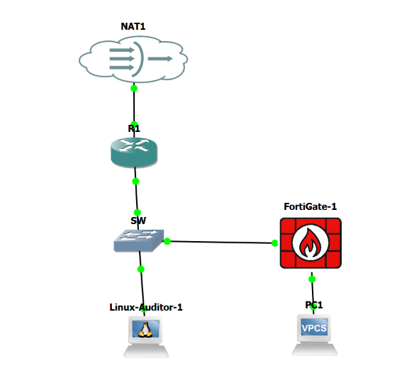

| Tipo | Archivo | Vista previa |
|---|---|---|
| Cisco R1 y SW | [`cisco_01_topologia_gns3_real.png`](cisco_01_topologia_gns3_real.png) |  |
| Cisco R1 y SW | [`cisco_02_conectividad_inicial.png`](cisco_02_conectividad_inicial.png) | 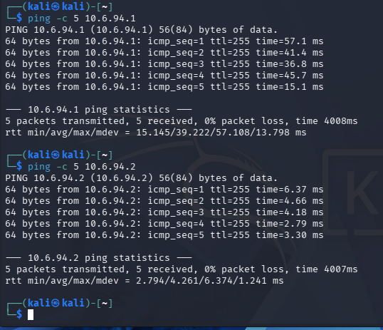 |
| Cisco R1 y SW | [`cisco_03_netmiko_router.png`](cisco_03_netmiko_router.png) | 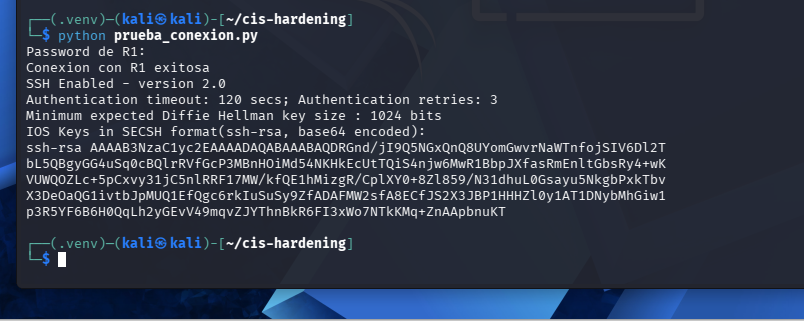 |
| Cisco R1 y SW | [`cisco_04_netmiko_switch.png`](cisco_04_netmiko_switch.png) | 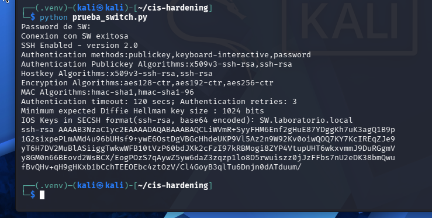 |
| Cisco R1 y SW | [`cisco_05_auditoria_inicial_8_de_14.png`](cisco_05_auditoria_inicial_8_de_14.png) | 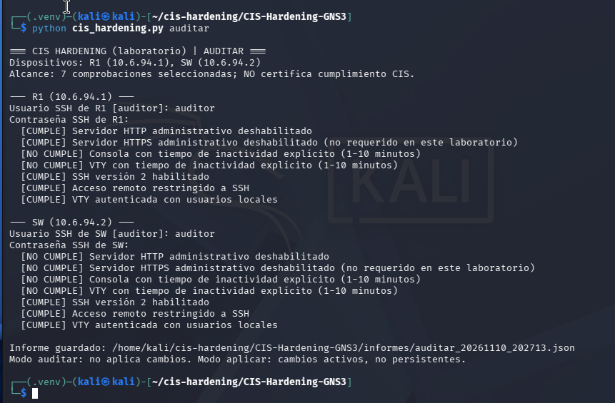 |
| Cisco R1 y SW | [`cisco_06_autorizacion_hardening.png`](cisco_06_autorizacion_hardening.png) | 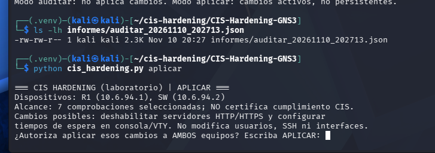 |
| Cisco R1 y SW | [`cisco_07_aplicacion_R1.png`](cisco_07_aplicacion_R1.png) | 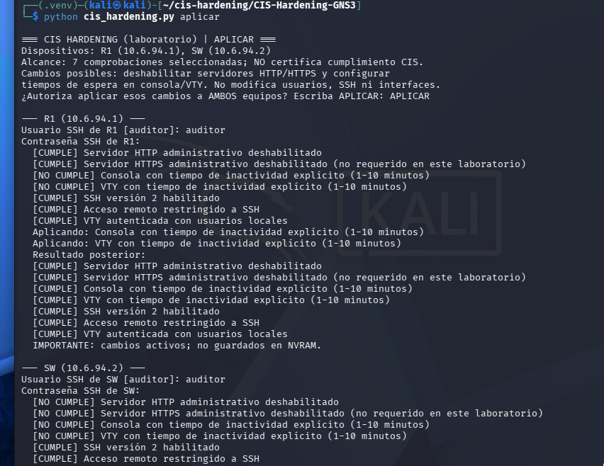 |
| Cisco R1 y SW | [`cisco_08_aplicacion_SW.png`](cisco_08_aplicacion_SW.png) | 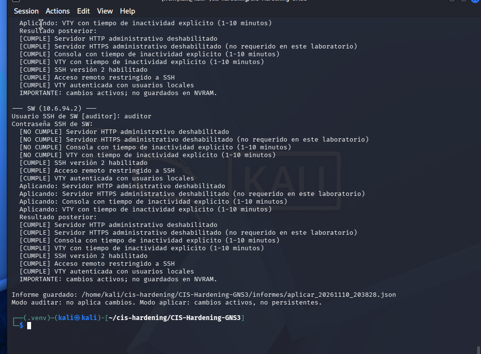 |
| Cisco R1 y SW | [`cisco_09_auditoria_final_14_de_14.png`](cisco_09_auditoria_final_14_de_14.png) | 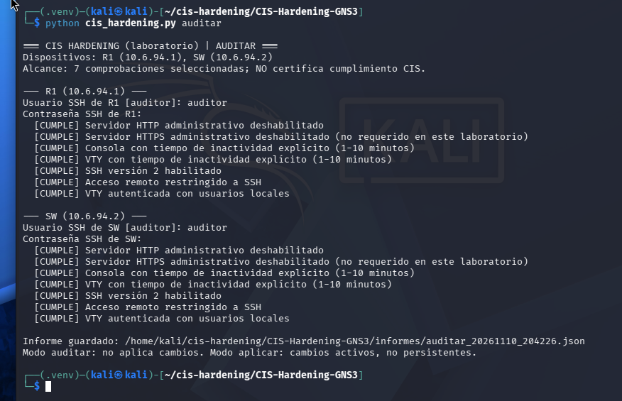 |
| Cisco R1 y SW | [`cisco_10_conectividad_final.png`](cisco_10_conectividad_final.png) | 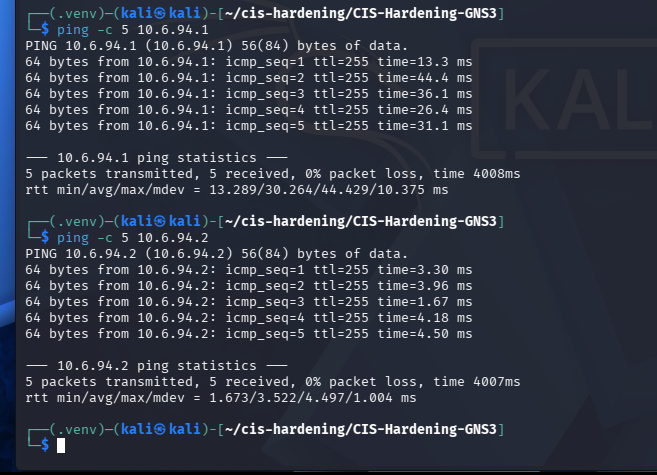 |
| Cisco R1 y SW | [`cisco_11_lista_informes_originales.png`](cisco_11_lista_informes_originales.png) | 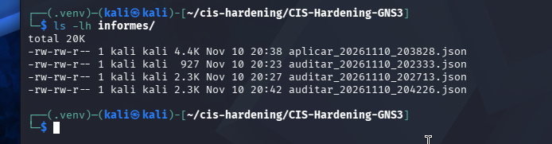 |
| Demostración de auditoría conjunta (16/21) | [`demostracion_auditoria_inicial_16_de_21.png`](demostracion_auditoria_inicial_16_de_21.png) | 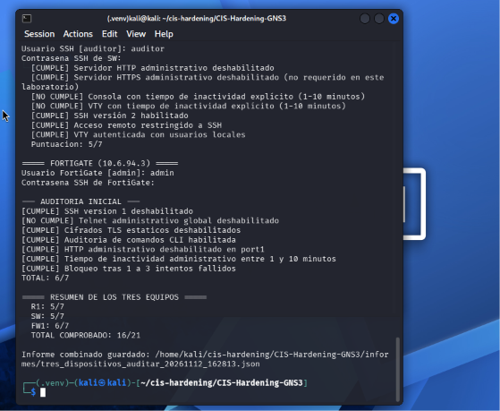 |
| Diagramas de red y procesos | [`diagrama_flujo_auditoria.png`](diagrama_flujo_auditoria.png) | 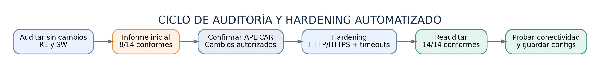 |
| Diagramas de red y procesos | [`diagrama_flujo_tres_dispositivos.png`](diagrama_flujo_tres_dispositivos.png) | 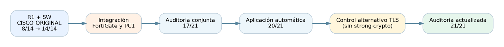 |
| Diagramas de red y procesos | [`diagrama_topologia_ampliada.png`](diagrama_topologia_ampliada.png) | 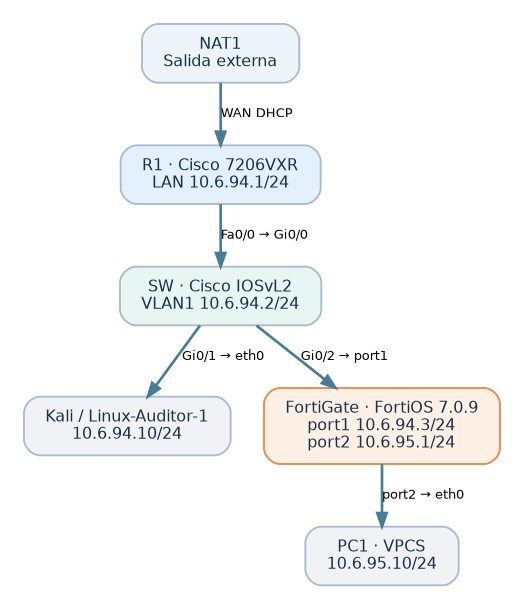 |
| Diagramas de red y procesos | [`diagrama_topologia_gns3.png`](diagrama_topologia_gns3.png) | 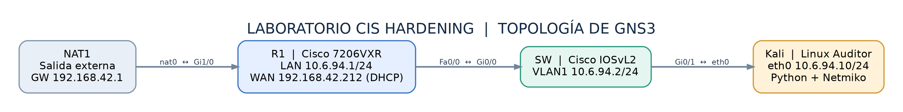 |
| FortiGate y red completa | [`fortigate_01_topologia_gns3_router_switch_fortigate_pc_kali.png`](fortigate_01_topologia_gns3_router_switch_fortigate_pc_kali.png) |  |
| FortiGate y red completa | [`fortigate_02_ping_kali_fortigate_5_5.png`](fortigate_02_ping_kali_fortigate_5_5.png) | 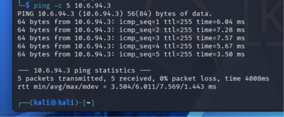 |
| FortiGate y red completa | [`fortigate_03_ssh_kali_fortigate_exitoso.png`](fortigate_03_ssh_kali_fortigate_exitoso.png) | 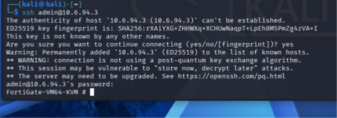 |
| FortiGate y red completa | [`fortigate_04_auditoria_inicial_fortigate_3_7.png`](fortigate_04_auditoria_inicial_fortigate_3_7.png) | 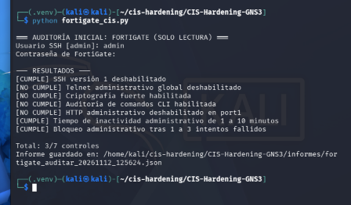 |
| FortiGate y red completa | [`fortigate_05_auditoria_conjunta_inicial_17_21.png`](fortigate_05_auditoria_conjunta_inicial_17_21.png) | 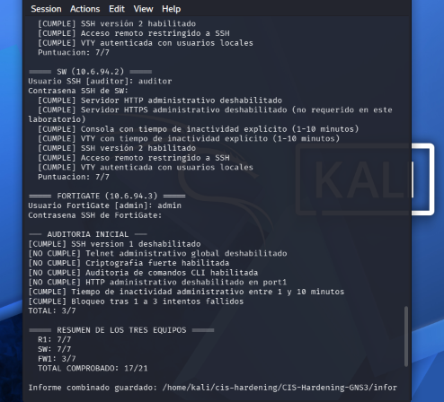 |
| FortiGate y red completa | [`fortigate_06_hardening_fortigate_20_21.png`](fortigate_06_hardening_fortigate_20_21.png) | 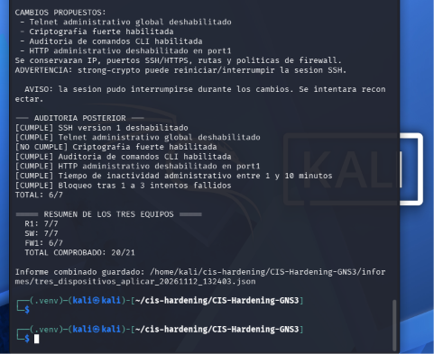 |
| FortiGate y red completa | [`fortigate_07_auditoria_final_tres_dispositivos_21_21.png`](fortigate_07_auditoria_final_tres_dispositivos_21_21.png) | 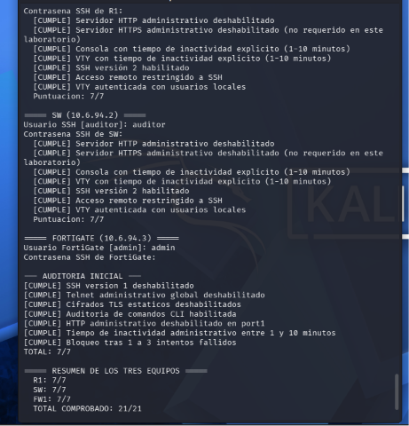 |
| FortiGate y red completa | [`fortigate_08_informe_json_tres_dispositivos.png`](fortigate_08_informe_json_tres_dispositivos.png) | 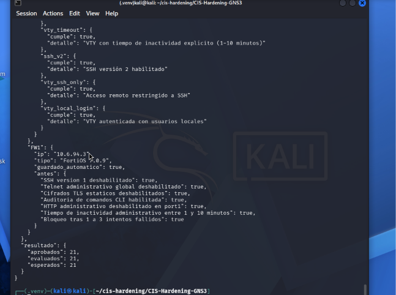 |
| FortiGate y red completa | [`fortigate_09_transferencia_gns3_disco.png`](fortigate_09_transferencia_gns3_disco.png) | 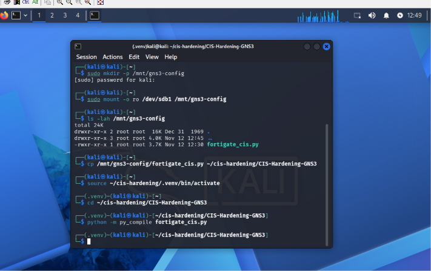 |
| FortiGate y red completa | [`fortigate_10_exportacion_evidencias_gns3.png`](fortigate_10_exportacion_evidencias_gns3.png) | 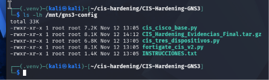 |

**Nota:** los archivos con prefijo `cisco_` son capturas originales del trabajo de R1 y SW; no se alteró su contenido. La topología principal del README muestra únicamente la infraestructura completa con FortiGate.
